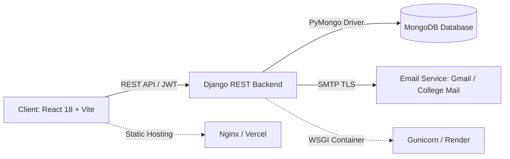

# PeerGear | Peer-to-Peer Campus Equipment Exchange & Smart Escrow Platform

[](https://python.org)
[](https://djangoproject.com)
[](https://mongodb.com)
[](https://react.dev)
[](https://vitejs.dev)
[](https://tailwindcss.com)
[](https://docker.com)

**PeerGear** is an end-to-end peer-to-peer equipment sharing and rental marketplace built specifically for university campuses. It allows verified college students to securely lend and borrow academic equipment, calculators, lab coats, sports gear, cameras, project electronics, and bicycles with built-in financial security deposits, dual-OTP handovers, and photographic condition ledgers.

---

## 🌟 Key Platform Capabilities

### 1. 🎓 Verified Student Identity & Trust System
- **Mandatory Campus Verification**: Multi-step onboarding with live Email OTP verification and College ID Card upload.
- **Admin Document Moderation**: Campus moderation console where administrators review, approve, or reject student ID cards with custom reason feedback.
- **Trust Badges & User Profiles**: Verified student badges, exchange history, hostel block location tags, and peer accountability scores.

### 2. 🛡️ 100% Refundable Security Deposit Escrow
- **Escrow Wallet Engine**: Digital deposit wallet protecting equipment owners against damage or loss.
- **Automated Hold & Refund**: Security deposits are locked in escrow when a booking is confirmed and automatically returned to the borrower's wallet upon undamaged return inspection.
- **Financial Audit Ledger**: Comprehensive transaction tracking for top-ups, rental earnings, escrow holds, and refunds.

### 3. 🤝 Secure Handover & Photographic Condition Ledger
- **Digital Handover OTPs**: 4-digit verification codes generated for physical pickups and returns to eliminate disputes regarding who received or returned an item.
- **Before-Pickup & After-Return Photo Proof**: Real-time condition logging storing side-by-side photographic condition evidence in the exchange ledger.

### 4. 📢 Campus Requests Board ("Notify Me")
- Students can broadcast requests for urgent practical equipment, calculators, or project components.
- When an owner lists a matching resource, automated system notifications alert requesting students instantly.

### 5. 🛡️ Administrative Portal & Dispute Resolution
- **Standalone Admin Console**: Dedicated route (`/admin-login`) for authorized university administrators.
- **Interactive Moderation Dashboard**:
  - Review pending student ID verifications with side-by-side image inspection.
  - Audit live campus rentals and resolve active disputes.
  - Inspect student directory with one-click account moderation and status toggling.

### 6. 📱 Mobile-First Responsive Experience
- Full native-app feel on mobile devices with an iOS-style bottom tab bar (`Explore`, `Requests`, floating `+ List`, `Rentals`, and `Profile`).
- Touch-friendly design with native momentum scrolling, safe-area inset padding, and auto-zoom prevention.

---

## 🏗️ Architecture & Technology Stack



### Frontend
- **Framework**: React 18 with Vite build tooling
- **Styling**: Tailwind CSS with custom responsive utilities
- **State & Context**: Modular AuthContext and ToastContext
- **Icons**: Lucide React
- **API Client**: Axios with automatic JWT interceptors and multipart upload fallbacks

### Backend
- **Framework**: Python 3.11+ / Django 4.x
- **API Architecture**: Modular Django apps (`accounts`, `items`, `rentals`, `demand_requests`, `analytics`)
- **Authentication**: Stateless JWT authentication with salted password hashing
- **Security**: CORS headers, strict referrer policy, X-Frame options, and request sanitization
- **Email Delivery**: SMTP with TLS support for live OTP and notification dispatches

### Database (MongoDB)
- **Driver**: PyMongo native driver
- **Data Modeling**: Dynamic JSON/BSON document schema supporting diverse equipment categories
- **Optimization**: Compound indexes (`category`, `availability_status`, `rental_rate_per_day`) and MongoDB `$text` search indexes for fast catalog lookups
- **Analytics**: Aggregation pipelines for campus impact metrics and revenue reporting

---

## 🚀 Quickstart & Local Installation

### Prerequisites
- Python 3.10+
- Node.js 18+ and npm
- MongoDB Community Server (Running locally on `mongodb://localhost:27017/`)

### 1. Clone the Repository
```bash
git clone https://github.com/21ambuj/PeerGear.git
cd PeerGear
```

### 2. Backend Setup
```bash
# Install Python dependencies
pip install -r requirements.txt

# Run database setup (indexes & validation)
python scripts/setup_mongo_indexes.py

# (Optional) Seed initial demo catalog and admin account
python scripts/ensure_admin_user.py

# Start Django development server
python manage.py runserver 127.0.0.1:8000
```
*Backend API will run at: `http://127.0.0.1:8000/api/`*

### 3. Frontend Setup
```bash
cd campusshare_frontend

# Install dependencies
npm install

# Start development server
npm run dev
```
*Frontend application will run at: `http://localhost:5173`*

---

## 🐳 Docker Deployment

To launch the complete platform (MongoDB, Django API, and Nginx React Frontend) in isolated production containers with a single command:

```bash
docker compose up -d --build
```

- **Web Frontend**: `http://localhost` (Port 80)
- **Backend API**: `http://localhost:8000` (Port 8000)
- **MongoDB**: `localhost:27017`

---

## ☁️ Cloud Deployment Options

### Option 1: Managed Cloud (Render + Vercel)
1. **Backend on Render**:
   - Create a Web Service connected to your repository.
   - Set Build Command: `pip install -r requirements.txt`
   - Set Start Command: `gunicorn campusshare_backend.wsgi:application --bind 0.0.0.0:$PORT`
   - Configure environment variables from [.env.production.example](.env.production.example).
2. **Frontend on Vercel**:
   - Import the `campusshare_frontend` directory.
   - Framework preset: `Vite`.
   - Set Environment Variable: `VITE_API_URL=https://<your-render-backend-url>/api`.

### Option 2: Docker / Virtual Private Server (AWS / DigitalOcean / Linode)
- Clone the repository onto your host.
- Copy `.env.production.example` to `.env` and configure your credentials.
- Run `docker compose -f docker-compose.yml up -d`.

---

## 📡 API Overview

| Method | Endpoint | Description |
| :--- | :--- | :--- |
| `POST` | `/api/accounts/register/` | Register new student account |
| `POST` | `/api/accounts/login/` | Authenticate student and issue JWT token |
| `POST` | `/api/accounts/verify-email-otp/` | Verify 6-digit email registration OTP |
| `POST` | `/api/accounts/upload-id-card/` | Upload student ID card proof (Base64 / Multipart) |
| `POST` | `/api/accounts/admin/login/` | Authenticate campus administrator |
| `GET` | `/api/accounts/admin/users/` | Retrieve student directory and pending verifications |
| `POST` | `/api/accounts/admin/users/<id>/verify-id/` | Approve or reject student ID card with reasons |
| `GET` | `/api/items/` | Browse catalog with search, category, and price filters |
| `POST` | `/api/items/create/` | List new equipment for campus exchange |
| `POST` | `/api/rentals/book/` | Book item with automated escrow deposit hold |
| `POST` | `/api/rentals/verify-pickup/` | Verify pickup with OTP and log initial photo proof |
| `POST` | `/api/rentals/verify-return/` | Complete return inspection and release escrow deposit |
| `GET` | `/api/requests/` | View active campus demand requests board |
| `GET` | `/api/analytics/summary/` | Aggregate platform utilization and impact metrics |

---

## 🔒 Security Best Practices
- **No Committed Secrets**: All sensitive API keys and SMTP credentials are managed via environment variables (`.env`).
- **Input Sanitization**: Multi-layer validation on all user payloads and document uploads.
- **Scoped Permissions**: Role-based access control isolating student endpoints from administrative moderation tools.
- **Sanitized Media Handling**: Uploaded verification files and condition photos are validated by MIME-type and size.

---

## 📄 License
This project is open-source and available under the [MIT License](LICENSE).
